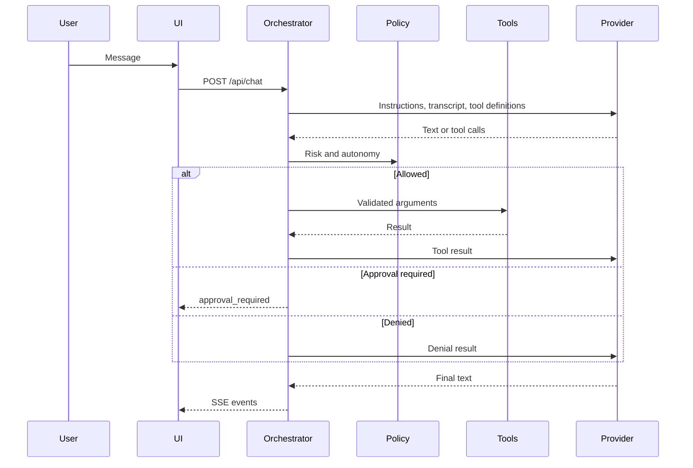

# Architecture

This document describes the system that is implemented now and the decisions that later phases should keep. It is the source of truth for module boundaries. The README is the source of truth for local setup.

## Decisions

- Maximus runs as one local Node.js process with a browser interface. It is not a hosted multi-user service and it is not split into microservices.
- The process binds to loopback unless `MAXIMUS_API_TOKEN` is set.
- SQLite, through Node's built-in `node:sqlite`, is the only database. Retrieval is keyword search. Embeddings are not used.
- The database file stays out of OneDrive by default because sync can corrupt SQLite.
- The default model is local Ollama (`llama3.2`) through its OpenAI-compatible chat endpoint. It is free and does not send conversations to a paid API. Grok remains available through the Responses API when `MAXIMUS_PROVIDER=grok`.
- Voice input and spoken replies use the browser speech APIs. Text input still works when the microphone or speech engine is unavailable.
- Responses are not stored on the provider by default (`store: false`). The local transcript is the conversation record.
- Provider responses are normalized before the orchestrator sees them. Tests use `ScriptedProvider` and do not call the network.
- Built-in xAI tools such as web search and code execution are not enabled. They would run outside this permission system.
- Voice, image understanding, and embeddings have separate future providers. `grok-4.7` accepts text and images and returns text; speech is a different API and is not wired up.
- Default autonomy is level 2: reads and local low-risk writes run immediately. Consequential actions wait for approval. Destructive actions are denied at every level until an explicit confirmation design exists.
- A model request may be retried. A tool that already started is not retried after a crash or a second approval.

Published model facts were checked against xAI's docs on 2026-10-09: [Grok 4.7](https://docs.x.ai/developers/grok-4-7), [function calling](https://docs.x.ai/developers/tools/function-calling), [models and pricing](https://docs.x.ai/developers/models), and [voice](https://docs.x.ai/developers/model-capabilities/audio/voice).

## Request path

## Modules

- `src/config.ts` validates environment settings.
- `src/providers` defines `ChatProvider` and the Grok adapter.
- `src/orchestration/engine.ts` owns the turn loop, limits, and approval pause.
- `src/tools` owns manifests, schemas, and `evaluatePolicy`.
- `src/db` owns SQLite migrations and repositories.
- `src/http/app.ts` is the HTTP boundary. The browser only renders events from that API.

## Limits

A turn stops after 120 seconds, 8 tool rounds, and 12 tool calls unless those settings are changed. Tool results sent back to the model are capped. One response that asks for more than 32 tools is rejected and none of those tools run.

## Next work

1. Approved long-term memory with deletion that removes derived copies.
2. A persisted task state machine for multi-step work.
3. Speech-to-text and text-to-speech behind their own interfaces, leaving this text loop intact.
4. An allowlisted file-read tool. Shell and browser automation stay out until they have a tighter permission model than a prompt.
